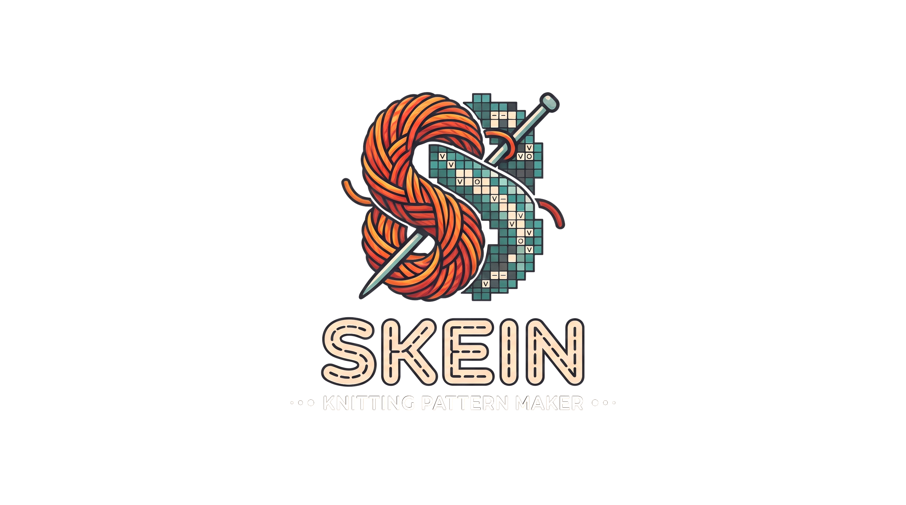

  

  
  
  
  
  

  
  
  
  
  
  

  
  
  

> [!WARNING]
> **Active Refactor in Progress**  
> The codebase is currently undergoing a structural MVC refactor. Master branch builds and APIs may shift rapidly.

---

## What is Skein?

**Skein** is a fast, native Linux chart editor designed specifically for knitters, fiber artists, and pattern designers.

Unlike general-purpose pixel art editors or rigid spreadsheets, Skein treats knitting charts as two distinct, harmonious layers: **yarn colorwork** and **technical stitch symbols**. Whether you are drafting stranded colorwork mittens, complex lace shawls, or textured cable sweaters, Skein gives you a distraction-free vector canvas that scales effortlessly from tiny swatches to massive blankets.

---

## Highlights

* **Sharp Vector Canvas:** Smooth Cairo-rendered vector grid that remains crisp at any zoom level without raster pixelation.
* **Dual-Layer Editing:** Draw yarn colors and apply technical symbols (Knit, Purl, Yarn Over, Decreases, Slips) independently on the same cell.
* **Adaptive Symbol Contrast:** Stitch symbols automatically calculate the luminance of the yarn color underneath, dynamically switching between light and dark ink for clear legibility.
* **Instant Undo & Redo:** Full transactional history tracking allows you to experiment freely and reverse any brush stroke, bucket fill, or repeat marker.
* **Pattern Repeat Outlines:** Tag repeating motif sections with visual bounding boxes, hover highlights, and row-count tooltips.
* **Custom Palettes:** Right-click any color swatch in the bottom toolbar to pick and customize your working yarn palette using a native color wheel.
* **Lightweight Project Files:** Save and reopen your charts in portable `.skn` project files without bloated file sizes.

---

## Tools Breakdown

| Tool | Icon / Name | Description |
| :--- | :--- | :--- |
| **Move** | Arrow | Pan and reposition your view of the canvas by clicking and dragging. |
| **Paint** | Brush | Paint yarn colors onto the grid. Click individual cells or click-and-drag continuous lines. |
| **Fill** | Paint Bucket | Flood-fill connected areas of the same color or empty canvas in a single click. |
| **Erase** | Eraser | Reset cells back to blank canvas, clearing colors and symbols. |
| **Picker** | Eyedropper | Sample any yarn color directly from your chart into your active swatch. |
| **Stitch** | Grid / Symbol | Place technical knitting glyphs. Adapts the bottom toolbar palette to display symbols. |
| **Repeat** | Refresh / Loop | Click and drag vertically over rows to define a repeatable chart section. |

---

## Navigation & Shortcuts

| Action | Control |
| :--- | :--- |
| **Draw / Place / Fill** | `Left Click` or `Left Click + Drag` |
| **Pan Canvas** | `Left Click + Drag` (Move tool) |
| **Zoom In / Out** | `Ctrl + Mouse Wheel Scroll` |
| **Undo** | `Ctrl + Z` |
| **Redo** | `Ctrl + Y` |
| **Customize Palette Color** | `Right Click` on any swatch in the bottom toolbar |
| **Inspect Repeat Details** | Hover your cursor over repeat markers on the canvas margin |

---

## Installation & Setup

### Requirements

* Linux (Arch, Debian, Ubuntu, Fedora, etc.)
* GTK4 (version 4.10 or newer)
* Cairo & JSON-GLib libraries
* A C compiler (`clang` or `gcc`) and `make`

### Install Dependencies on Arch Linux

    sudo pacman -S clang pkgconf gtk4 cairo json-glib base-devel
    git clone https://github.com/keepo-dot/skein
    cd skein

### Install Dependencies on Debian / Ubuntu

    sudo apt update
    sudo apt install -y clang pkg-config libgtk-4-dev libcairo2-dev libjson-glib-dev build-essential
    git clone https://github.com/keepo-dot/skein
    cd skein

---

## Building & Launching

Compile and launch Skein using the included Makefile:

    # Build the binary
    make

    # Launch the application
    ./bin/skein

    # Clean intermediate build files
    make clean

---

## Quick Start Guide

1. **Start a Chart:** Launch the app. Use the bottom toolbar to start fresh with custom stitch width and row height dimensions.
2. **Set Your Yarn Colors:** Right-click any swatch on the bottom toolbar to match your physical yarn colors.
3. **Draw Your Motif:** Choose the **Brush** to sketch colorwork, or use the **Bucket** to fill background areas quickly.
4. **Add Stitch Textures:** Select the **Stitch** tool to reveal the symbol palette in the bottom toolbar. Choose purls, yarn-overs, or decreases to overlay structural texture over your colors.
5. **Mark Repeats:** Switch to the **Repeat** tool and drag along the rows you want to designate as repeat sections.
6. **Save Your Work:** Use the Save icon to export your pattern to a `.skn` file for later editing.

---

## Looking for Technical Details?

Interested in how Skein is architected under the hood? For deep dives on the **Model-View-Controller (MVC) separation**, **memory-managed flood fill**, **non-linear history stack**, and **Cairo drawing pipelines**, visit:

* [Architecture & Technical Design Documentation](docs/ARCHITECTURE.md)

---

## Roadmap

* [x] Non-recursive stack flood fill algorithm.
* [x] Non-linear compound undo/redo history.
* [x] Interactive repeat sections with hover inspector.
* [ ] Selection tool with copy/paste for duplicating motifs.
* [ ] Export charts directly to high-resolution PNG, SVG, and printable PDFs.
* [ ] Written instruction generator (e.g. converting grid rows to text: *"Row 1: K2, P2, K2..."*).
* [ ] Flat vs. Circular knitting view toggles (Wrong Side purl visual logic).
* [ ] Fair Isle float length alert checker.
* [ ] Real-world gauge calculator with physical dimension preview.

*See [ROADMAP.md](docs/ROADMAP.md) for the full, detailed feature pipeline.*

---

## License

**Skein** is open-source software licensed under the [GNU General Public License v3.0](LICENSE).
